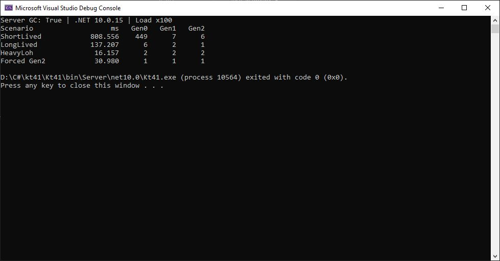
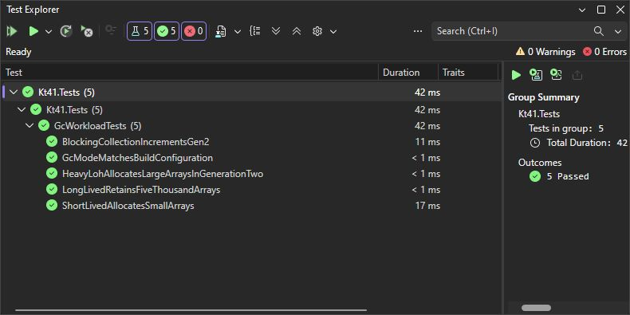

# КТ №41. Параллельная и фоновая сборка мусора

Вариант 1 — симуляция нагрузки. C#, .NET 10, Visual Studio 2026.

## Запуск

1. Откройте `Kt41.sln` в Visual Studio 2026 с рабочей нагрузкой **.NET desktop development**.
2. Выберите проект запуска `Kt41` и профиль «Базовая нагрузка» или «Нагрузка ×100».
3. Для Workstation GC выберите `Release`, для Server GC — `Server`. Запустите программу через **Ctrl+F5**.
4. Чтобы проверить выбранную конфигурацию, откройте **Test → Test Explorer** и запустите все тесты. Для Server GC нужны минимум два логических процессора.

| Сценарий | Размер массива | Базовая нагрузка | ×100 |
| --- | ---: | ---: | ---: |
| `ShortLived` | 200 байт | 300 000 | 30 000 000 |
| `LongLived` | 512 байт | 5 000 | 500 000 |
| `HeavyLoh` | 100 000 байт | 20 | 2 000 |

`ms` — время этапа по `Stopwatch`. Столбцы Gen0–Gen2 показывают прирост счётчиков сборки. `Forced Gen2` — отдельный замер блокирующего `GC.Collect`.

## Результаты

В Visual Studio 2026 при нагрузке ×100 в режиме Server GC этап `HeavyLoh` добавил две сборки Gen2. Блокирующий вызов добавил ещё одну сборку Gen2 и занял 30,980 мс. При повторных запусках время и счётчики могут отличаться. По счётчикам нельзя определить, была ли конкретная сборка фоновой.

В Test Explorer прошло 5 из 5 тестов.

